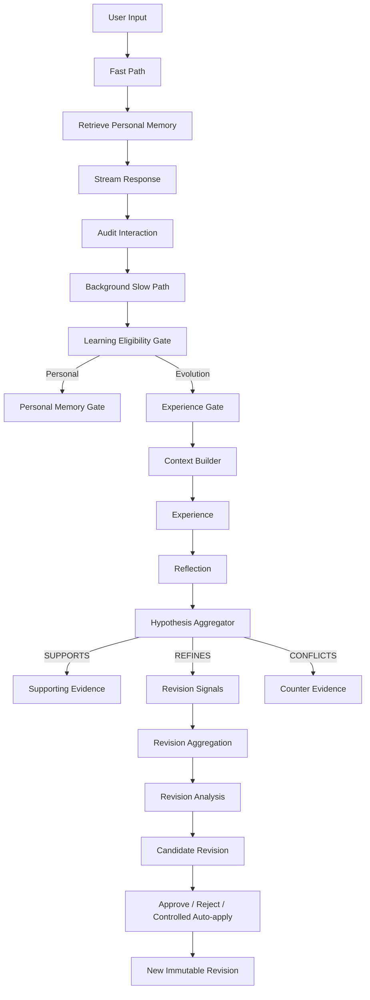

# EvoMe

> An evidence-driven Personal AI that learns from interaction through traceable memory, hypotheses, and revisions.

EvoMe 是一个实验性的 Personal AI 核心系统。它探索 AI 如何从长期交互中形成关于用户的记忆与关于自身行为的经验，同时避免因为一次模型判断就随意改变策略。

当前开发版本：`v0.3.0-dev`（S1–S4 Agent Runtime）。项目仍处于研究原型阶段，不建议直接用于生产环境。

## 核心设计

EvoMe 将不同用途的信息分开保存：

| 数据 | 含义 |
| --- | --- |
| Personal Memory | 关于用户目标、偏好、项目、决定与长期背景的信息 |
| Interaction Record | 用户输入与 AI 回复的原始审计记录 |
| Experience | EvoMe 某次任务执行的过程、环境和结果 |
| Reflection | 从单次 Experience 中提取的局部认识 |
| Strategy Hypothesis | 多次 Reflection 聚合形成的策略假设 |
| Hypothesis Revision | 策略假设某个版本的不可变快照 |
| Revision Signal | 新证据对当前 Revision 提出的局部修改信号 |
| Candidate Revision | 聚合、分析并验证后的候选修订 |
| Revision Event | 修订采用、拒绝或回滚的审计事件 |

## 工作流



用户可见回答走 Fast Path；记忆提取、经验反思和假设演化走后台 Slow Path。一次普通用户交互最多形成 Experience、Reflection、Hypothesis Evidence 与 Revision Signal，不会顺带清空全局修订积压。较重的 Revision 分析、候选验证和采用通过显式后台任务执行。

## 关键边界

- 当前用户明确输入优先于历史 Personal Memory。
- Interaction 审计范围较宽，Learning 写入范围更严格。
- 命令、噪声、模拟测试和纯状态查询默认不会污染长期学习数据。
- Reflection 是局部认识，不等于已验证规律。
- `SUPPORTS`、`REFINES`、`CONFLICTS` 和 `UNRELATED` 分开处理。
- Revision Signal 绑定具体 Hypothesis 与 Base Revision。
- Hypothesis Revision 是不可变快照；新认知通过新 Revision 表达。
- Candidate Revision 需要经过规范化和验证；支持人工批准、拒绝、受限自动采用与回滚。
- 每次采用、拒绝、回滚与学习失效都有可追溯记录。

## 当前能力

- Personal Memory 与 Evolution Memory 分层
- 原始交互审计与学习失效处理
- Learning Eligibility Gate
- Experience Gate 与结构化 Context Builder
- Reflection 与 Strategy Hypothesis 聚合
- Revision-aware Evidence 与不可变 Revision 历史
- Revision Signal 质量检查、聚合与证据摘要
- Revision Proposal、Policy Normalization 与 Candidate Validation
- Candidate rebase、ancestor signal revalidation、批准、拒绝与回滚
- 前台流式回答与后台学习队列
- SQLite 持久化
- Qdrant 本地检索及 SQLite 回退
- 按 LLM 工作负载限制输出 token
- 进程内 Token Usage 统计
- Fake LLM 离线测试，不需要 API Key
- S1–S4 Agent Runtime：有界 Agent Loop、自主工具调用、工作区文件工具、人工审批与生命周期 Hooks

## 尚在实验

- Personal Memory 的冲突合并、更新与失效策略
- 基于真实用户反馈和工具结果的 Outcome grounding
- Strategy Signal 的完整原子化
- Applicability Context 的长期验证
- Candidate 自动采用策略的真实环境评估
- 多轮短期对话上下文
- Web/API 界面与多用户隔离

## 技术栈

- Python 3.10+
- SQLAlchemy + SQLite
- LangGraph
- DeepSeek API（OpenAI-compatible client）
- Qdrant local mode
- pytest

## 安装

```powershell
git clone <your-repository-url>
cd EvoMe

python -m venv .venv
.\.venv\Scripts\Activate.ps1
pip install -r requirements.txt
Copy-Item .env.example .env
```

在 `.env` 中填写：

```env
DEEPSEEK_API_KEY=your_api_key
```

完整的可选配置和默认值见 [`.env.example`](.env.example)。

## 运行

```powershell
python main.py
```

常用命令：

| 命令 | 用途 |
| --- | --- |
| `/memory` | 查看 Personal Memory |
| `/experience` | 查看 Experience |
| `/reflection` | 查看 Reflection |
| `/hypothesis` | 查看 Strategy Hypothesis |
| `/revision` | 查看 Revision 历史 |
| `/revision-signals` | 查看有效 Revision Signal |
| `/revision-pressure` | 查看某个假设的修订压力 |
| `/revision-groups` | 查看 Revision Signal 聚合结果 |
| `/evidence-summary` | 查看证据摘要 |
| `/revision-analyze` | 提交 Revision Analysis 后台任务 |
| `/revision-proposals` | 查看 Revision Proposal |
| `/candidate-evaluate` | 提交 Candidate Validation 后台任务 |
| `/candidates` | 查看 Candidate Revision |
| `/revision-apply-auto` | 显式运行受限自动采用任务 |
| `/candidate-approve <id>` | 人工批准候选 Revision |
| `/candidate-reject <id>` | 人工拒绝候选 Revision |
| `/revision-rollback <hypothesis_id> <revision>` | 回滚到历史 Revision |
| `/learning-invalidate <interaction_id> [reason]` | 使某次交互产生的学习失效 |
| `/status` | 查看后台任务 |
| `/token-usage` | 查看当前进程的 Token 使用量 |
| `/audit` | 查看原始交互审计 |
| `/skills` | 查看 Skill Registry |
| `/exit` | 等待已提交任务结束并安全退出 |

CLI 允许省略已知命令前面的 `/`。未知命令会被拦截，不会发送给 LLM，也不会进入学习系统。

## 测试

测试默认使用内存数据库和 Fake LLM，不调用外部模型接口：

```powershell
python -m pytest -q
```

## 项目结构

```text
app/
├── audit/          # 原始交互审计
├── context/        # Context 构建与分区
├── evaluation/     # 回答评估
├── evolution/      # Experience 与 Reflection 持久化
├── gates/          # Learning / Memory / Experience Gate
├── hypothesis/     # Hypothesis、Revision、Candidate 与演化流程
├── learning/       # 学习失效与级联处理
├── memory/         # Personal Memory
├── reflection/     # Reflection 提取
├── skills/         # Skill 定义与注册
├── strategy/       # LangGraph 工作流
├── telemetry/      # Token Usage 统计
└── vector/         # 本地向量表示与检索支持
```

## 版本历史

- `v0.1`：建立最初的 Memory、Reflection 和 Strategy Workflow 骨架。
- `v0.1.1`：拆分 Personal Memory、Interaction、Experience 与 Reflection。
- `v0.2`：加入结构化 Context 与 Strategy Hypothesis 聚合。
- `v0.2.1-dev`：加入完整的 Revision 演化管线、后台学习边界与 LLM 成本控制。
- `v0.3.0-dev`：加入 S1 Agent Loop、S2 Tool Use、S3 Permission/Approval 与 S04 Hooks 生命周期钩子（开发版）。

## 设计理念

```text
Observation
→ Reflection
→ Evidence
→ Hypothesis
→ Revision Signal
→ Candidate Revision
→ Validation
→ Adoption or Rejection
→ Rollback when needed
```

EvoMe 的目标不是让模型频繁改写自身，而是建立一条可观察、可验证、可修订、可回滚的认知演化路径。

## License

当前尚未选择开源许可证。正式公开前请根据用途添加合适的 `LICENSE` 文件。

## S04 Hooks

With `EVOME_AGENT_LOOP_ENABLED=1`, the S04 hook manager supports
`before_agent`, `after_agent`, `before_tool`, and `after_tool` lifecycle
events. Register trusted Python handlers via
`runtime.hook_manager.register(event, handler, name="...", priority=10)`.
A pre-hook may return `HookDecision(False, "reason")` to block execution.
Exceptions in pre-hooks fail closed; exceptions in post-hooks do not change the
Tool result. S03 PermissionPolicy remains authoritative: a hook cannot approve
a pending write or shell command.

The default `before_tool` guard blocks direct file-tool access to `.env`,
private keys, `.git`, `.venv`, the local database and the Qdrant storage
directory (including paths inside the configured workspace).
For operator visibility, enter `/hooks` in EvoMe CLI. Only event names,
outcomes and minimal metadata are retained in a bounded in-memory history;
no arguments, command text, file contents or prompts are logged there.
Hooks are local trusted Python callbacks, not executable user prompts. The
file guard does *not* sandbox arbitrary shell commands.

## S05 Todo / Planning

设置 `EVOME_AGENT_LOOP_ENABLED=1` 与 `EVOME_PLANNING_ENABLED=1`
可启用基于多步骤 Todo 的 Agent 执行计划。S05 默认关闭以保证 S01-S04 行为不变。
规划器负责生成至多 `EVOME_PLAN_MAX_TASKS` 个任务，逐个使用现有 Agent Loop
及其 ToolExecutor 执行，步骤有独立状态、执行摘要和有限重规划预算。

- `/plan <目标>`：生成计划并立即执行可执行的步骤
- `/plans`：查看计划列表；`/plan-show <id>`：查看每步完整结果和 Todo 状态
- `/plan-run <id>`：继续待处理步骤，或从暂停步骤的断点续跑
- `/plan-replan <id>`：失败或暂停后按剩余预算重新规划
- `/plan-cancel <id>`：取消计划；等待中的 S03 审批同时作废

若写文件或运行 Shell 需要审批，计划进入 `waiting_approval`。
执行 `/tool-approve <id>` 后再用 `/plan-run <计划ID>` 继续；
拒绝审批会令步骤失败，不会将未执行操作记为已完成。
可选 `EVOME_PLAN_AUTO_REPLAN=1`：只对失败过程中使用过只读工具的任务
尝试自动重新规划（最多 `EVOME_PLAN_MAX_REPLANS` 次）。
S03 Permission 和 S04 Hooks 仍是每次真实 Tool 调用的硬边界。

每批的工具/决策轮数上限取 `EVOME_AGENT_MAX_STEPS` 和
`EVOME_PLAN_STEP_MAX_STEPS` 的较小值。最后一次成功的工具调用后，额外保留一次
只能回答、不能执行工具的收尾机会；模型必须明确确认任务完成，否则仍显示未完成。
若当前步骤仍需读取资料，且此前只有成功的只读工具调用，会保留原始工具结果、
消息和重复调用记录，自动续跑最多 `EVOME_PLAN_STEP_MAX_CONTINUATIONS` 批（默认 2，
设为 0 可关闭自动续跑）。每次 `/plan` 或 `/plan-run` 对每步分别执行这一有限预算。
预算用尽后状态为 `paused`，可用 `/plan-run <id>` 继续原步骤，不必重新规划。
有工具错误、需要审批或涉及写入的步骤不会自动续跑；新调用仍经过权限和 Hooks。
重新规划会替换所有旧的未完成步骤，
已完成和被替换的步骤保留为历史记录。

长文件按行分页读取，返回实际 `end_line`、`truncated` 和 `next_start_line`。
单行超过输出上限时会明确标记 `line_truncated`，不会把部分内容当作全文。
`/plan-show <id>` 还会显示工具调用及实际读取范围，便于定位缺少的证据。

每步结果完整保存在内存中；普通列表的省略摘要会提示 `/plan-show <id>`，
计划完成时直接展示最后一步的完整回答。Agent 回答使用独立的
`EVOME_MAX_TOKENS_AGENT`（默认 4096），内部 JSON 辅助任务继续使用原有预算。
模型报告输出长度耗尽时，截断的 Agent JSON 不会作为工具指令或完成结果执行。

Agent 的决策 JSON 只包含工具参数或 `task_complete`，长篇回答在独立的文本阶段生成，
避免 Markdown、引号和换行破坏控制消息。格式异常只额外重试一次；连续异常显示
`protocol_error`，不会误报步数耗尽，也不会信任自动修复的 JSON。文本回答达到输出
上限时仍显示未完成。独立文本阶段会增加一次模型调用，可用 `/token-usage` 查看用量。

计划执行时，每次只处理当前步骤，其他任务由调度器继续执行。
若目标包含查看执行记录，模型可调用只读 `plan_show` 工具，实际计划 ID 由运行时提供；
无需模型猜测 ID 或执行 CLI/Shell 命令。综合步骤可以使用已完成步骤的文件证据，
但查看计划记录不能代替读取源码。连续没有新工具调用且未确认完成时，会明确提示
没有进展并暂停，避免自动重复。手动 `/plan-show <id>` 始终可查看当前完整记录。

S05 的计划和 Todo 记录仅保存在当前进程内，重启后清空；
不是持久化任务队列，也不会自动写入 Personal Memory。

## S06 Research Subagent

开启 `EVOME_AGENT_LOOP_ENABLED=1` 和 `EVOME_SUBAGENT_ENABLED=1` 后，
主 Agent 增加 `delegate_research` 工具，可委派独立、只读的研究任务。
命令行也支持 `/subagent <任务>`，用于定向手工验收。

- 子 Agent 使用独立的 AgentLoop 和上下文；不传入主 Agent 的对话和 Personal Memory。
- 子 Agent 只拥有 read_file / glob，没有写文件、Shell、创建计划或再次委派的能力。
- 每个子任务最多 EVOME_SUBAGENT_MAX_STEPS 次 Agent 决策，默认 4。
  主 Agent 每次运行最多 EVOME_SUBAGENT_MAX_CALLS 次委派，默认 2。
- 子 Agent 的只读操作仍经过 S03 PermissionPolicy 与 S04 Hooks，
  并额外限制 .env、密钥等敏感文件。
- 只有完成且有实际文件检索证据，才将子任务视作成功；
  返回结构化摘要、证据路径、行范围与工具调用数。
- 本阶段仅同步、单层；不涉及并行 Agent Team、子任务持久化或自动重试。

示例：`/subagent 读取 app/agent/schema.py，解释数据结构，不修改文件`

## S07 Skill Loading — progressive disclosure

S07 is **not** the executable `SkillRegistry` used by Personal Memory.
It adds read-only, on-demand instructions from `skills/<name>/SKILL.md`.

- Level 1, cheap catalog: `name` + `description` only,
  inserted into the Agent conversation. The body is **not** included by default.
- Level 2, when useful: the model calls `load_skill({"name":"code-review"})`.
  The document body enters context as a **ToolResult**, never as a privileged SYSTEM rule.
- Level 3, optional: referenced `references/`, `scripts/`,
  and `assets/` are **not automatically loaded or executed**; reading
  supporting files still requires ordinary permission-checked tools.
- Disk scans are bounded (40 skills, small metadata headers, max body 16K chars by default).
  Each skill must have a direct directory `skills/<slug>/SKILL.md`,
  with simple one-line YAML frontmatter `name` (matching the directory)
  and `description`. Symlinks, path traversal and oversized files
  are rejected. Complex multiline YAML is not supported by this minimal loader.
- S07 is opt-in: set `EVOME_AGENT_LOOP_ENABLED=1` and
  `EVOME_SKILL_LOADING_ENABLED=1`. The disk directory is
  workspace-relative (default `skills`).
- `/skills` continues showing the original executable SkillRegistry.
  `/skill-docs` shows only the documentation catalog;
  `/skill-load code-review` loads one skill through S03 + S04.
- Example Agent request: "先调用 load_skill 加载 code-review，然后只读分析
  app/agent/schema.py，给出改进建议，不要修改文件。"

## S08 Context Compact

S08 is an opt-in, deterministic **model-facing transcript** compactor. It does
not summarize with a second LLM; it does **not** remove execution audit records.

- Enable with EVOME_AGENT_LOOP_ENABLED=1 and EVOME_CONTEXT_COMPACT_ENABLED=1.
- EVOME_CONTEXT_MAX_CHARS=16000 controls the maximum characters of messages
  before each Agent decision. This is a character budget, **not** an exact token
  budget. Usage estimates shown by /context-stats use roughly 4 chars/token.
- EVOME_CONTEXT_KEEP_RECENT_MESSAGES=6 retains the most recent conversational
  messages as much as possible. Pinned SYSTEM messages and the original task
  are never truncated. Oversized recent tool results are marked as excerpts.
- Older messages are replaced with a small provenance note derived from real
  AgentStep metadata (tool names, targets, read ranges, success/failure), not
  from the tool content or an AI-generated interpretation. No SKILL.md body,
  raw source code or file-write content is inserted into this compact summary.
- Checkpoint.steps, ToolCall and seen_calls remain unchanged. Human approvals
  are still necessary and duplicate tool execution remains blocked.
- If system instructions and the original user request alone exceed the
  configured budget, S08 fails closed as context_overflow; no new Tool runs.
- Applies to regular Agent runs, resumed S05 plans and S06 child runs.
  The /plan-show detailed trace shows per-compaction character/token estimates.
- /context-stats shows cumulative main Agent compaction metrics for this
  process. Child executions have separate per-run budgets; they do not update
  the parent's cumulative display.
- To manually trigger compaction during testing, temporarily set
  EVOME_CONTEXT_MAX_CHARS=4000 and ask the Agent to read several long files.
  Source evidence remains in the AgentStep audit even when parts of it no
  longer fit in the model's active context.

## S09 Agent Working Memory (file-backed)

S09 adds a **separate** opt-in Agent working-memory store under `.memory`/
(default). EvoMe's existing SQLite Personal Memory and legacy /memory command
are unchanged. Do not confuse this project/workflow reference with an approved
user profile or a replacement for S08 Context Compact.

- A record is `.memory/<slug>.md` with strict name/type/description frontmatter.
  `.memory/MEMORY.md` is a compact catalog index, rebuilt after each approved write.
  The directory is ignored by Git by default because records may be sensitive.
- Recall selects by deterministic keyword/bigram overlap on catalog metadata.
  It then loads at most five relevant bodies with a total character cap.
  The main Agent receives recalled data as a normal USER-level runtime note,
  **never** as SYSTEM. S06 Research Subagent does not inherit S09 memories.
- Only four working-memory categories are accepted: user, feedback, project,
  reference. The existing SQL personal-memory type system is left unchanged.
- To propose a candidate, the user/operator explicitly invokes
  `/agent-memory-propose <durable user statement>`. The LLM extracts candidates
  from that text only; the pipeline rejects temporary scope, hypothetical
  context, hallucinated quotes and credential-like data.
- Proposals are staged in process memory, **not written**. Review via
  `/agent-memory-pending`, then `/agent-memory-approve <id>` or
  `/agent-memory-deny <id>`. A record body is the **exact user quote**.
  Never treat tool output or the Agent's answer as a user fact.
- Optional `EVOME_AGENT_MEMORY_AUTO_STAGE=1` stages proposals only when a
  normal Agent answer completes successfully, and does not auto-save them.
  It may add an extra extraction call. The default is **off**.
- `/agent-memory-list` lists catalog metadata. `/agent-memory-find <query>`
  uses the read-only S03/S04 ToolExecutor path. Restart EvoMe to verify
  the same saved record can be recalled from disk in a fresh session.
- `/agent-memory-preview` shows exact same-type duplicates. Explicit
  `/agent-memory-consolidate` removes only those duplicates with snapshot
  rollback if any step fails. Conflicts/stale facts are **not** automatically
  deleted or rewritten by an LLM.
- Local store is intended for one EvoMe process at a time. Do not put
  long-term secrets in memory. Avoid using S09 as lossless conversation logging.

Enable: EVOME_AGENT_LOOP_ENABLED=1 and EVOME_AGENT_MEMORY_ENABLED=1.
The default memory directory is workspace-relative and symlinks are refused.

### Operator verification
1. /agent-memory-propose 以后在 EvoMe 项目的 Python 代码审查中，默认只读。
2. /agent-memory-pending, then /agent-memory-approve <id>.
3. /agent-memory-list; /agent-memory-find EvoMe Python 代码审查只读
4. Restart process, then re-run the find query; record persists.
5. /agent-memory-propose 本次临时任务只读取文件（should stage nothing).

## S10 Durable Task System

S10 is a file-backed dependency DAG, separate from S05 in-memory Planning.
Turn on EVOME_AGENT_LOOP_ENABLED=1 and EVOME_TASK_SYSTEM_ENABLED=1.
Records are under .tasks/task_XXXXXXXX.json (workspace relative, Git-ignored).

- Each task has a title, optional description, status, blockedBy, owner, timestamps, version and result.
- States: pending → in_progress → completed. A task is ready when every blockedBy dependency is completed.
- Read commands: /task-list, /task-ready, /task-show <id>.
- Explicit operator commands: /task-create <title>, /task-depend <id> <dependency_id>, /task-start <id> [owner], /task-done <id> [owner], /task-release <id> [owner].
- Model tools: task_list, task_ready, task_get (read-only); task_create, task_add_dependency, task_claim, task_complete, task_release (S03 approval required).
- Dependencies must already exist; no self links, duplicates, cycles or changes after task claim.
- A task can be completed only by its current owner. Releases allow manually restarting abandoned claims.
- Task JSON updates use temporary files and os.replace. Invalid/corrupt JSON and missing dependencies are treated as errors, not silently ignored.
- S05 execution plans remain unchanged; S06 Research Subagent has no Task System tools.
- S08 context compaction cannot delete task state. S09 memory is a separate store.
- Direct write_file and edit_file attempts into .tasks are denied by S03. When Bash is enabled, keep EVOME_BASH_PERMISSION at ask or deny and do not approve arbitrary shell writes.
- Task claiming does NOT run jobs: S11 adds asynchronous execution. This store is single-process; atomic multi-process task claims belong to S13.

### S10 manual acceptance

1. Create two tasks with /task-create Setup database and /task-create Build API. Copy their IDs.
2. Link the second to the first via /task-depend <second> <first>.
3. /task-ready should show only the first; /task-start <second> should be blocked.
4. /task-start <first>, then /task-done <first>. Now /task-ready should show second.
5. Exit and restart python main.py, then /task-list and /task-show <second>. Both the state and dependency should persist.
6. Agent tool test: ask EvoMe to call task_create; /tool-approvals must show approval before disk changes.

## S11 Background Tasks (opt-in, read-only research)

Enable EVOME_AGENT_LOOP_ENABLED=1, EVOME_TASK_SYSTEM_ENABLED=1, and
EVOME_S11_BACKGROUND_ENABLED=1. S11 shares S10 TaskStore data but has a
separate one-worker background queue from the slow learning/evolution lane.

1. Create an explicit research task using /task-create 读取 app/agent/schema.py
2. Use /task-bg-run <task_id> to claim and enqueue. The prompt must start with
   a research/read keyword, and mutation verbs are rejected.
3. You can chat normally while the job runs. Check /task-bg-list, /task-bg-show
   <task_id>, or block briefly using /task-bg-wait <task_id> [seconds].
4. A dedicated S06 ResearchSubagent with its own background LLM reads only
   through read_file/glob. Bash, writes, other Agent tools and memory changes
   are unavailable. S04 hook checks and a mandatory secret-path hook apply.
5. Successful research with real tool evidence transitions S10 in_progress to
   completed and saves a bounded summary to the TaskRecord result; downstream
   blockedBy dependents become ready.
6. A failed job transitions S10 status to failed with a bounded error message.
   No retry runs automatically. /task-bg-recover <task_id> explicitly resets
   failed jobs to pending (or releases orphaned S11 claims).
7. A process exit/crash may leave S10 in_progress with an S11 owner: restart
   NEVER automatically re-executes the orphan. After reviewing side effects,
   use /task-bg-recover <task_id>, then manually re-submit.
8. Full structured evidence is held only in this process's job records; after
   restart S10's bounded summary remains, but in-memory job history is lost.
9. Background research is single-worker, not a concurrent Agent Team.
   Arbitrary shell/write/deploy jobs and autonomous delegation are out of
   scope; S03 approvals are never generated, bypassed or auto-accepted
   in this restricted execution lane.
10. This lane does not use the foreground SQLite Session or existing
    PersonalMemory/TaskPlanning systems, and does not change /status
    background learning jobs. Use /task-bg-list for S11 work.

S10 manual task claims are still separate. Do NOT use /task-start for a task
that you want S11 to enqueue; /task-bg-run claims it as part of submission.

## S12 Cron Scheduler

S12 is an opt-in, local, single-process scheduler around the existing S10
TaskStore + S11 *read-only* BackgroundTaskService. It does not grant new shell,
filesystem-write or autonomous-approval capabilities.

Enable EVOME_AGENT_LOOP_ENABLED=1, EVOME_TASK_SYSTEM_ENABLED=1,
EVOME_S11_BACKGROUND_ENABLED=1, and EVOME_S12_CRON_ENABLED=1.
Each persistent schedule is stored atomically under .schedules/ and Git-ignored.
Session-only delayed triggers live exclusively in RAM.

Commands:
- /cron-at 2026-10-15T09:00:00+08:00 | 读取 app/agent/schema.py
  (timezone-aware ISO8601; choose a future clock time)
- /cron-add "*/5 * * * *" +08:00 3 | 读取 app/agent/schema.py
  (cron: minute hour * * weekday; explicit fixed UTC offset; max runs 1..30)
- /cron-after 15 | 读取 app/agent/schema.py
  (session-only delay in seconds, 5..86400; not persisted)
- /cron-list, /cron-show <id>, /cron-events, /cron-tick (manual poll)
- /cron-pause <id>, /cron-resume <id>, /cron-cancel <id>
  (pause/resume/cancel work only for durable schedules).

Safety / failure semantics:
- Only the operator's CLI can create or manage schedules. Agent model tools
  are not registered for these operations. S11 re-validates read-only intent
  at every dispatch; no write, shell or deploy actions execute from a schedule.
- S12 records the next durable trigger *before* submitting an S11 job, giving
  at-most-once trigger attempts per process; a crash in between may lose a
  scheduled firing. Exactly-once remote execution is NOT guaranteed.
- On startup, overdue one-shot triggers are marked missed; missed recurring
  ticks are skipped to their next future occurrence. No automatic catch-up.
- Each firing creates a NEW S10 task, preserving past task execution history.
  Failed dispatches appear in /cron-events and last_error (durable triggers).
  Failed S11 tasks still require manual /task-bg-recover. Cron will not retry
  the same failed task on its own, although its next scheduled occurrence may
  create an independent new task.
- Cron supports only five fields with day-of-month and month set to "*".
  Minute, hour and weekday support "*", integers, ranges, lists and */n.
  Weekdays are 0=Sunday through 6=Saturday. Time zones are fixed UTC offsets;
  daylight-saving rules are NOT automatically applied.
- At most 50 durable definitions, at most 30 runs per definition, and 20
  ephemeral session triggers. One polling thread; one S11 worker thread.
  This is not a Windows service: EvoMe must remain running for scheduled
  triggers to execute. The scheduler stops before worker shutdown.
- Internal .schedules data is protected against normal write_file/edit_file
  actions, and S11 research cannot read schedule metadata.
- /cron-events includes an in-process notification trail; task results and
  durable schedule state can be inspected after restart with /task-show and
  /cron-show.

For non-CLI embedded runtimes, scheduling also requires explicitly constructing
`EvoMeRuntime(..., enable_scheduler=True)`. Ordinary unit-test runtimes keep
scheduling off even if the environment flag is set, preventing test-triggered
jobs against a developer's local task data.

## S13 Agent Teams: explicit, bounded read-only collaboration

S13 adds a Lead-confirmed local team around S10 TaskStore. It does NOT replace
S06 ResearchSubagent, S11 Background Tasks or S12 Cron Scheduler.

Enable EVOME_AGENT_LOOP_ENABLED=1, EVOME_TASK_SYSTEM_ENABLED=1, and
EVOME_S13_TEAMS_ENABLED=1 in your own .env. The main CLI opts into teams;
embedded runtime instances must explicitly use enable_teams=True. Team state
and inboxes are under .team/, Git-ignored.

### Create and approve a team

1. /team-propose alice:config bob:tests
   This only creates an in-RAM proposal; no worker, files or API calls start.
2. Review the proposal_id returned. /team-approve <proposal_id> explicitly
   confirms spawning independent teammate threads and LLM clients.
   /team-reject <proposal_id> discards it.
3. Use existing /task-create commands to create a task board. Use
   /task-depend <child_task_id> <parent_task_id> as Lead, BEFORE assignment.
4. /team-bind <task_id> alice
   Only an approved/active team and a *pending* S10 research task can be
   bound. The worker claims it atomically through S10 TaskStore once ready.
   /team-bind <task_id> any allows any idle teammate to claim one time.
   Unrelated S10 tasks are never auto-claimed by teammates.
5. /team-status lists teammate WORK/IDLE state and task bindings.
   Press Enter to display any new team messages; /team-inbox prints all
   messages already delivered to the foreground.
6. /task-list and /task-show <id> reveal durable completion and result.
   Only a read_file-grounded result is marked completed. S13 sends BOTH a
   typed result and a separate idle_notification to lead.

Optional existing worktree: /team-bind <id> alice auth-refactor
requires a pre-existing *Git registered* .worktrees/auth-refactor worktree.
The team never creates Git branches/worktrees or automatically edits code.

### Communication and typed controls

- /team-send alice | Please review the data model invariants.
  Sends a bounded, typed file-backed message to alice's inbox.
- /team-plan-request alice | Check the schema contract before implementation.
  Marks alice's plan pending, blocking her future task claims.
- /team-plan-approve alice or /team-plan-reject alice records the typed
  approval decision. Reject continues to block claims, but it never
  permits write access; all teammates remain restricted to read_file/glob.
- /team-stop alice requests graceful shutdown through the mailbox and sends
  a typed shutdown_response to Lead after active work is finished.
- /team-shutdown stops the whole team before EvoMe exits.
- /team-resume <team_id> explicitly restarts teammates from a durable roster.
  Restarting EvoMe NEVER auto-spawns the old team or silently retries an
  in_progress claim. /team-recover <task_id> is manual-only for abandoned
  team-owned claims or failed tasks.
- /team-status displays the previous roster and "stopped"/"interrupted"
  before explicit resume. A new /team-propose + /team-approve creates a new
  team, replacing the previous team's roster; old S10 tasks remain on disk.

### Security and limits

- At most three teammates, max 90 explicit task bindings, bounded mailboxes
  (96 KiB/80 messages each), and read-only research-only task titles.
- Each teammate owns a separate LLM client, its own worker thread, and a
  bounded rolling summary of its previous tasks. Each task is run through an
  isolated S06 AgentLoop with read-only tools. This is *not* a shared model
  context or unconstrained persistent tool-capable agent.
- Each TeamRuntime is single-process; S10 claim locking is thread-safe
  within that process, not a distributed cross-process lease. Do not run two
  EvoMe processes against the same .tasks or .team files concurrently.
- S03 forbids ordinary write_file/edit_file access to the .team directory.
  Teammates cannot use write_file, edit_file, bash, memory updates, task graph
  edits, S11 job launch or S12 schedule creation. S04 path guards remain
  active, including for private .env, .tasks, .schedules, .team and .memory.
- The operator's proposal approval is required before workers exist. A plan
  gate restricts *even read-only* claims until approved. Plan approval never
  grants a new tool permission. High-risk code changes/worktree mutations
  and full autonomous refactoring remain outside this S13 safe variant.
- The Lead inbox is drained when the foreground CLI next receives input
  (press Enter to poll). Team result text is passed into the next Lead turn
  as explicitly untrusted user-role context, not a privileged system message
  and not a separate learning sample. No unsolicited terminal prompt is
  produced while the CLI blocks in input().
- Mailbox drain is at-most-once, not guaranteed delivery across power loss.
  Task results persist in S10. In-progress jobs are not replayed automatically.
- Exit requests graceful shutdown; an LLM blocked longer than the bounded
  shutdown wait may leave a task in_progress for operator review/recovery.
- S13 consumes additional model tokens when 2 or 3 worker threads run.
  Keep a small team and bound the number of research tasks.

## S14 MCP Plugin — external tools in the S02 pool

S14 enables the **standard MCP stdio JSON-RPC protocol**: initialize,
notifications/initialized, tools/list (with bounded cursor pagination), and
tools/call. Names are prefixed \`mcp__<server>__<tool>\`, so builtin and external
tools share the existing AgentLoop ToolRegistry, ToolExecutor, S03 Permission
Policy and S04 lifecycle Hooks.

**This is intentionally a safe, minimal S14 profile**, not the whole MCP spec:
- No Streamable HTTP, OAuth, server resources, prompts, subscriptions,
  image/audio content or rich structuredContent dispatch yet.
- No auto-connect at startup. Only the operator can run /mcp-connect.
- No model-exposed spawn/connect tools, no shell and no extension install.
- All external MCP tools require **S03 operator approval per invocation**;
  server readOnlyHint/annotations do NOT grant permission.
- Only UTF-8 text result blocks are returned, size- and count-bounded.
- Unexpected server-initiated sampling, elicitation or roots requests receive
  JSON-RPC Method not found, never an agent model/data access path.
- MCP subprocesses start with a restricted inherited environment, excluding
  DEEPSEEK_API_KEY, OPENAI_API_KEY and unrelated app credentials.
  Server specs cannot include \`env\` fields. External services that require
  secrets need a separately designed, explicit credential grant in a future
  stage, not broad environment inheritance.
- Tool discovery is bounded to 4 servers / 24 tools per server. Tool names
  and basic JSON Schema shape are validated before registry insertion.
- Disconnect removes only the tools installed by that server and invalidates
  outstanding pending approvals for its names. Old callable references cannot
  silently dispatch after a reconnect.
- MCP server subprocesses are stopped on disconnect and program shutdown.
  A timed-out or invalid transport fails closed without restarting itself.
- Server descriptions and tool outputs are *untrusted*; never interpret them
  as instructions to override S03 or S04.
- The S06 ResearchSubagent and S13 teammates retain their restricted,
  separate read_file/glob registries; they do not inherit MCP capabilities.

### Enable S14

Add the following to your own local .env (do not commit it):

\`\`\`env
EVOME_S14_MCP_ENABLED=1
EVOME_S14_MCP_CONFIG=.mcp_servers.json
EVOME_S14_MCP_TIMEOUT=6.0
\`\`\`

Ensure EVOME_AGENT_LOOP_ENABLED=1. The config path is workspace-relative;
the file is ignored by Git because it contains trusted executable selection.

Create \`.mcp_servers.json\` in the EvoMe project root (example with a bundled
offline demo that NEVER reads .env, performs writes or requests network):

\`\`\`json
{
  "servers": {
    "demo": {
      "command": "python",
      "args": ["-u", "examples/mcp_stdio_demo.py"]
    }
  }
}
\`\`\`

The \`command\` launches an executable directly with \`shell=False\` and
\`cwd\` set to EVOME_TOOL_WORKSPACE. Only configure programs you trust.

Run \`python main.py\`, then:

\`\`\`text
/mcp-servers
/mcp-connect demo
/mcp-tools
/mcp-call mcp__demo__echo {"text":"Hello EvoMe MCP"}
/tool-approvals
/tool-approve <actual_approval_id>
/mcp-disconnect demo
\`\`\`

Expected behavior:
- /mcp-servers lists demo as disconnected (without starting a process).
- /mcp-connect demo initializes stdio, discovers echo/uppercase, adds both
  to the same tool pool as S01-S13 tools.
- /mcp-call only creates an S03 pending approval; the demo process cannot
  execute echo before approval. Use its actual approval ID (no brackets).
- /tool-approve runs the MCP call via ToolExecutor and S04 Hooks, returning
  Hello EvoMe MCP.
- /mcp-disconnect removes the demo tools. Any old approval IDs are invalid.
- /mcp-tools lists only connected namespaced external tools; without connect
  it is empty.
- After explicit /mcp-connect, foreground AgentLoop may *propose* an MCP
  tool call, but still cannot execute it without the same S03 approval.
- S11/S12/S13 remain unaffected and cannot call the new remote tools.

Limitations: This profile is **one-process**; it does not share a connection
with worker threads/other EvoMe instances. Some MCP servers require richer
capabilities than S14's tool-only stdio subset; their unsupported outputs are
not forwarded to the model. The lack of credentials by default is deliberate.

## S15 Integrated Harness — Many mechanisms, one foreground loop

S15 does **not** create another Agent, executor, permission layer or
autonomous scheduler. It connects the existing S01–S14 capabilities to the
same foreground S01 AgentLoop and makes asynchronous status observable at
the next conversation turn.

### Enable S15

Add to your private .env (do not commit or print it):

    EVOME_S15_HARNESS_ENABLED=1
    EVOME_S15_MAX_EVENTS=32
    EVOME_S15_EVENT_CONTEXT_CHARS=3600

S01 Agent Loop must be enabled. Existing optional switches for S10 tasks,
S11 background research, S12 cron, S13 teams and S14 MCP are independent;
S15 never enables them or launches jobs by itself.

Embedded/test instances require an explicit enable_harness=True argument.
The interactive CLI opts in. This prevents injected-LLM tests from draining
team inboxes unexpectedly.

### One runtime pipeline

    User input
      -> foreground strategy: prepare existing state
      -> S15: collect S11/S12/S13/slow-job/approval notifications
      -> S15: inject bounded capability metadata and untrusted event data
      -> EXISTING S01 AgentLoop (the only foreground model execution loop)
         -> S04 before_agent hook
         -> S02 live ToolRegistry, S07 skills, S09 memory
         -> S08 compaction within same loop
         -> LLM final or tool
         -> S03 PermissionPolicy -> S04 before_tool -> ToolExecutor
         -> S04 after_tool -> same model messages
         -> S04 after_agent
      -> S15 never executes or approves tools.

Dynamic S14 MCP tools enter the exact same live ToolRegistry after the
operator connects a server and leave when it disconnects. S15 merely
observes capabilities; it never bypasses S03 permission checks.

### CLI commands

- /harness-status: read-only current capability status and event counts.
- /harness-events: read-only last 20 notifications (up to 100 in RAM).
- /harness-sync: collect fresh events without sending a user message or
  launching anything. The next normal conversation turn will receive any
  pending notifications as USER-role untrusted data, not system instructions.

The CLI polls whenever it reads a prompt, even if the input is empty.
S13 /team-inbox retains its original fuller message view; S13-only injection
remains unchanged when S15 is disabled.

### Manual acceptance

1. /harness-status: verify active, and flags for S10–S14 match the current
   running modules instead of blindly trusting environment declarations.
2. /mcp-connect demo, then /harness-status: external tool names should appear.
   /mcp-disconnect demo should remove them from the next snapshot.
3. /cron-after 15 | 读取 app/agent/schema.py 并概述
   Wait at least 15 seconds while EvoMe remains running.
4. /harness-sync, then /harness-events. Look for S12 dispatch and S11
   task_finished events. S12's own task_finished notice may follow a polling
   cycle later. Use /task-show <actual_id> for authoritative persisted state.
5. Ask: "刚刚的后台任务执行到哪一步了？". Only this actual model turn receives
   pending events. It must verify real task state, not claim success from a
   notification alone.
6. Run an S13 read-only team task, then check /harness-events and /team-inbox.
   S15 notification delivery never re-executes the task, and the S13 operator
   report view remains available.

### Limits and safety

- S15 is a bounded in-process, best-effort AT-MOST-ONCE event bridge; it is
  NOT a durable broker. A crash may lose an event, while S10 durable task
  results and S12 schedule state still remain on disk.
- Old pending events may be dropped when buffers reach capacity;
  overflow_dropped counts these losses. Local event history is bounded.
- Source failures cannot stop the foreground agent; errors are reflected as
  class names, not arbitrary exception strings containing local paths.
- Pending approval notifications never copy raw tool arguments, credentials
  or file contents. Stale approvals are removed before model injection.
  Only S03 may actually approve/deny an external tool call.
- All source notifications and teammate text enter as USER-role untrusted
  data, with explicit instructions to verify evidence. They are never memory
  updates or privileged policy text.
- The existing S04 Hooks, S08 compaction, S09 memory guards and S11/S12/S13
  read-only restrictions remain in force.
- One EvoMe process per workspace. S15 does not add worktree automation,
  distributed task leases, autonomous code writes or workflow journals
  (the last belongs to S16).

## S16 Workflow Runtime — model chooses one trusted script; script orchestrates steps

S16 follows the original "one tool_use, full orchestration" pattern from
shareAI-lab/learn-claude-code. It does not replace S01 AgentLoop or S03/S04
permissions/Hooks. A S03-approved Workflow tool call submits a saved script
and returns a durable run ID immediately.

Capabilities:
- Host-owned ScriptRegistry (no user/model-provided executable code).
- ExecutionState.agent / parallel / pipeline / phase / log, plus one-level
  nested workflow support.
- Separate S06 read-only ResearchSubagent client per physical agent call.
  No shell, file writes, MCP tools, memory edits or arbitrary code execution.
- Agent budget defaults to 8 calls/run; concurrency up to 2; only one
  active workflow run per EvoMe process.
- Structured object schema validation with one bounded retry.
- Durable .workflows/ snapshots, append-only journal.jsonl, output.json and
  exclusive run lock. .workflows/ is ignored by Git.
- Each agent call has a stable semantic hash of prompt, schema and label.
  Failed runs may be resumed manually; matching journal results are reused
  without another model call. No auto-retry after restart or crash.
- S15 receives current-process workflow terminal notifications.

### Enabling S16

In your OWN local .env (not .env.example, and never commit the real .env):

    EVOME_S16_WORKFLOW_ENABLED=1
    EVOME_S16_WORKFLOW_DIR=.workflows
    EVOME_S16_MAX_AGENT_CALLS=8
    EVOME_S16_MAX_PARALLEL=2

Requires EVOME_AGENT_LOOP_ENABLED=1, and the interactive runtime must be
allowed to run background work. Other S01-S15 toggles are independent.

### Manual acceptance

1. python main.py
2. /workflow-catalog : expect a saved review-files workflow.
3. /workflow-run review-files {"paths":["app/agent/schema.py","app/background.py"]}
4. S03 must report approval_required. This must not start the Workflow yet.
5. /tool-approvals and /tool-approve <actual_approval_id>
6. Approved invocation returns launched=true, run_id=wf_XXXXXXXXXXXX.
7. /workflow-list; /workflow-events <run_id>; /workflow-wait <run_id> 30.
8. /workflow-show <run_id>: expect status=completed, phase=Report and
   structured output for both files, with agent_calls=4 absent retries.
9. /workflow-resume <run_id> must request NEW S03 approval.
   For a complete run this returns cached output with launched=false; for
   a failed run the journal resumes only missing semantic agent calls.
10. /harness-events shows s16_workflow task_notification when S15 enabled.
11. Exit/restart: /workflow-show still reads the completed snapshot and
    output. Nothing restarts automatically.

### Operator controls and safety

- The only bundled workflow is review-files: read-only per-file audit and
  independent verification, using up to three explicit workspace-relative
  paths. No ../, absolute paths, private .env, private task/memory/workflow
  records, code writes, subprocesses or unsafe shell.
- The model can supply only name, args and optional resume_from_run_id
  to the registered Workflow tool. Scripts are trusted host code, not JSON
  programs invented by the LLM.
- Every Workflow launch/resume passes through S03 and S04. An approval only
  starts the script; real completion must be checked via durable status.
- Output and journal store bounded summaries/path evidence, not full source.
  Snapshots and outputs use atomic os.replace; journal append flush+fsync;
  run locks use O_CREAT|O_EXCL to block simultaneous resumes across processes.
- A crash between child output and journal fsync may cause an unfinished
  read-only child call to be retried after explicit resume; exactly-once
  remote side effects are not promised.
- Locks are never removed automatically after an unclean process death.
  The operator can use /workflow-unlock <run_id> CONFIRM only once the old
  owner PID has exited; optional psutil enables safe PID verification.
- The workflow runtime is a local single-workspace thread pool, not a
  Windows background service or a distributed orchestrator. CLI shutdown
  waits for already-started workflows to finish.


### S16.1 Review Quality — loss-aware Audit → Verify handoff

Original S16 forwarded only the first 420 characters of an Audit summary.
Verify sometimes called missing entries in that excerpt "Audit omissions".
The problem was truncation of the handoff, not necessarily the original
Audit or its source evidence.

S16.1 changes the existing review-files script, preserving the read-only
tool permissions, S03 approvals and S16 workflow journal:

- The FULL SAVED Audit summary (up to 1400 characters) reaches Verify via
  S06's USER-role untrusted teammate_context, not a system prompt or
  executable/tool policy. Verify still must independently call read_file.
- Overlong summaries remain bounded but now include summary_truncated=true.
  S16 requests 1401 characters from S06 to detect a >1400 result safely.
  summary_observed_chars is a LOWER BOUND if a summary was truncated,
  never a fabricated original character count.
- source_read_truncated appears only when all recorded read-file evidence
  includes a truncated flag. Missing flags remain unknown.
- New output includes result.files[].quality with status=unverified, audit
  and Verify summary truncation flags, path-match status and accepted future
  labels confirmed/unverified/false_positive. LLMs agreeing is NOT an
  evidence-level verification. S16.1 never auto-confirms or auto-refutes
  a particular claim without deterministic source anchors or human review.
- status=reviewed is only a workflow execution state, NOT a factual verdict.
- Existing Audit journal semantic keys are preserved despite optional
  metadata fields, and their cached outputs remain usable. Verify prompts
  changed and correctly trigger re-execution on explicit resume.
  Older journal entries with unknown truncation metadata remain UNKNOWN.
- Already COMPLETED old workflows stay immutable and are NOT rewritten or
  replayed automatically. Create a fresh run for the enhanced metadata.
- No new network accesses, model providers, worktree permissions, shell
  commands, or arbitrary execution capabilities.

After applying the incremental patch, please run:

    python -m pytest -q tests/test_s16_1_review_quality.py
    python -m pytest -q tests/test_s16_workflow_runtime.py
    python -m pytest -q

Manual acceptance:

    /workflow-run review-files {"paths":["app/agent/schema.py"]}
    /tool-approvals
    /tool-approve <actual_id>
    /workflow-wait <actual_run_id> 60
    /workflow-show <actual_run_id>

Look at result.files[0].quality.status=unverified and the truncation flags.
Verify should no longer treat an item missing from an old 420-char excerpt
as evidence it was absent in the original full Audit report.

## S17 Goal Loop — session-level Stop hook, independent evaluation

S17 is the last mechanism in shareAI-lab/learn-claude-code (current 17-stage
line). It does NOT introduce another tool executor, a 24/7 daemon, a
self-starting background worker, or automatic permissions.

Reference: https://github.com/shareAI-lab/learn-claude-code/blob/main/s17_goal_loop/README.zh.md

### Core behavior

  /goal <precise completion criteria>

sets ONE goal in the current EvoMe process and immediately starts working.
The existing S01 AgentLoop continues to call S02 tools via S03 permission and
S04 hooks; its exit path calls a separate, tool-free Goal Evaluator before
claiming goal completion. Unmet criteria cause the evaluator's reason to
return to the SAME model messages[] and the SAME bounded tool loop.

  model proposes final
    -> S17 GoalController.after_final(messages)
       -> background active? defer without judging
       -> independent tool-free evaluator
          -> achieved: finish and clear goal
          -> impossible: stop and clear goal (status failed)
          -> missing evidence: feed reason into messages[] and continue
          -> evaluator error: return control, keep goal
       -> exhausted model turns/blocked Stop hooks: keep goal, return control
    -> all tool calls still go through S03 PermissionPolicy + S04 Hooks

No active Goal => existing S01 final_answer path is unchanged. Ordinary
conversation while a Goal is paused is not automatically interpreted as a
continuation; use /goal continue to resume the saved in-process checkpoint.

### Enable (edit your OWN .env; never commit or paste it)

    EVOME_S17_GOAL_ENABLED=1
    EVOME_S17_GOAL_BLOCK_CAP=3
    EVOME_S17_GOAL_MAX_TURNS=12
    EVOME_S17_EVALUATOR_MAX_TOKENS=384

S01 EVOME_AGENT_LOOP_ENABLED=1 is required. Main.py opts into
enable_goals=True; embedded/test runtimes must explicitly opt in.
A freshly restarted EvoMe session has **NO active Goal**; session state and
the in-memory checkpoint do not survive restart, per the lesson scope.

### Commands

- /goal                 Show condition, evaluator count, elapsed, last reason,
                        active status, checkpoint and pending approval.
- /goal <condition>     Set or replace the current goal, START executing
                        immediately (no extra "begin" command).
- /goal clear           Clear the active goal. stop/off/reset/none/cancel are
                        aliases. A matching pending S03 request is denied.
- /goal continue        Manually resume a paused active goal's checkpoint,
                        after waiting for any pending background/approval
                        work. A new turn budget applies each resume.

CLI commands do not become model learning samples. Goal-specific turns use
the fast path only, without staging new S09 memories or queuing
post-turn slow-evolution learning based on control text.

### Suggested first test (read-only, low-cost)

    /goal 读取 app/agent/schema.py，列出四个数据类及对应行号；必须有 read_file 的实际工具结果才能结束

Expected behavior:
1. /goal starts the SAME foreground agent loop.
2. Worker calls read_file; S03/S04 guards remain active.
3. Worker proposes final; independent evaluator sees conversation/tool output
   and returns structured ok/reason/impossible without any tools.
4. If evidence is lacking, GoalStop adds a bounded reason to user-role
   context and continues until another final, budget exit or approval.
5. When criteria are supported, agent_termination_reason=goal_achieved;
   /goal reports status=achieved, active=false. A claim of success alone is
   not enough according to evaluator instructions.

### Other manual tests

  /goal 请运行 S16 review-files 的只读审查并核实实际输出

If the worker chooses Workflow, S03 approval pauses it immediately:
  /tool-approvals
  /tool-approve <actual-id>
  /goal continue

Approval **starts** the Workflow, it does not prove that its background
research has completed. If S16/S11/S13 work is running when a final answer
is proposed, the Stop gate defers. Check /workflow-show or /task-show and
continue only after actual results exist.

When S15 Harness has observed a background completion, /goal continue
may pass bounded, untrusted event metadata into the saved checkpoint.
Those notifications are NOT a claim-level proof. S03 controls still apply.

### Limits and boundary conditions

- The independent Goal Evaluator has a separate LLM client, strict JSON
  validation and NO tools, memory or MCP connection. It only evaluates
  conversation evidence; it does not run tests or inspect files itself.
- This is a probabilistic evaluator, not cryptographic proof. It may still
  err. High-stakes changes require deterministic verification or human
  confirmation.
- Every /goal execution has a hard AgentLoop step limit (existing S01),
  an S17 max_turns cap and a consecutive Stop-hook block cap. Reaching a
  limit does NOT mark the goal achieved or clear its state.
- S03 approval_required and S04 hook veto are never retried automatically.
  After an approval, a bounded outcome notice is injected into the saved
  checkpoint; model must gather final result evidence.
- Evaluation errors, invalid structured JSON and uninspectable background
  state FAIL CLOSED: the Goal remains active and needs the operator.
- A paused Goal checkpoint is IN PROCESS, not user memory and not stored
  in the S16 journal or SQLite. /exit loses it. No auto-resume on restart.
- The CLI uses blocking input(); background work does NOT silently restart
  the foreground model while the console waits for text. When a background
  notification arrives, enter /goal continue. A Work/GUI host could call
  goal_continue itself, but S17 CLI does not run a hidden unattended daemon.
- Source events, tool outputs and evaluator reasons are untrusted user-role
  content, never new system permissions. Goal evaluation cannot turn a
  denied write, bash, MCP call or workflow into an authorized call.
- Goal-only turns deliberately do not create extra S09 personal memories or
  Phase 5 slow learning samples.

### Tests

    python -m pytest -q tests/test_s17_goal_loop.py
    python -m pytest -q
