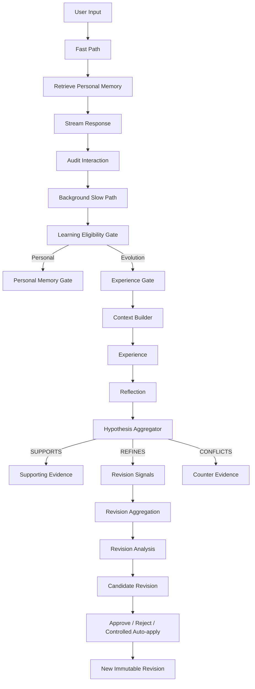

# EvoMe

> An evidence-driven Personal AI that learns from interaction through traceable memory, hypotheses, and revisions.

EvoMe 是一个实验性的 Personal AI 核心系统。它探索 AI 如何从长期交互中形成关于用户的记忆与关于自身行为的经验，同时避免因为一次模型判断就随意改变策略。

当前开发版本：`v0.3.0-dev`（S1–S4 Agent Runtime）。项目仍处于研究原型阶段，不建议直接用于生产环境。

## 核心设计

EvoMe 将不同用途的信息分开保存：

| 数据 | 含义 |
| --- | --- |
| Personal Memory | 关于用户目标、偏好、项目、决定与长期背景的信息 |
| Interaction Record | 用户输入与 AI 回复的原始审计记录 |
| Experience | EvoMe 某次任务执行的过程、环境和结果 |
| Reflection | 从单次 Experience 中提取的局部认识 |
| Strategy Hypothesis | 多次 Reflection 聚合形成的策略假设 |
| Hypothesis Revision | 策略假设某个版本的不可变快照 |
| Revision Signal | 新证据对当前 Revision 提出的局部修改信号 |
| Candidate Revision | 聚合、分析并验证后的候选修订 |
| Revision Event | 修订采用、拒绝或回滚的审计事件 |

## 工作流



用户可见回答走 Fast Path；记忆提取、经验反思和假设演化走后台 Slow Path。一次普通用户交互最多形成 Experience、Reflection、Hypothesis Evidence 与 Revision Signal，不会顺带清空全局修订积压。较重的 Revision 分析、候选验证和采用通过显式后台任务执行。

## 关键边界

- 当前用户明确输入优先于历史 Personal Memory。
- Interaction 审计范围较宽，Learning 写入范围更严格。
- 命令、噪声、模拟测试和纯状态查询默认不会污染长期学习数据。
- Reflection 是局部认识，不等于已验证规律。
- `SUPPORTS`、`REFINES`、`CONFLICTS` 和 `UNRELATED` 分开处理。
- Revision Signal 绑定具体 Hypothesis 与 Base Revision。
- Hypothesis Revision 是不可变快照；新认知通过新 Revision 表达。
- Candidate Revision 需要经过规范化和验证；支持人工批准、拒绝、受限自动采用与回滚。
- 每次采用、拒绝、回滚与学习失效都有可追溯记录。

## 当前能力

- Personal Memory 与 Evolution Memory 分层
- 原始交互审计与学习失效处理
- Learning Eligibility Gate
- Experience Gate 与结构化 Context Builder
- Reflection 与 Strategy Hypothesis 聚合
- Revision-aware Evidence 与不可变 Revision 历史
- Revision Signal 质量检查、聚合与证据摘要
- Revision Proposal、Policy Normalization 与 Candidate Validation
- Candidate rebase、ancestor signal revalidation、批准、拒绝与回滚
- 前台流式回答与后台学习队列
- SQLite 持久化
- Qdrant 本地检索及 SQLite 回退
- 按 LLM 工作负载限制输出 token
- 进程内 Token Usage 统计
- Fake LLM 离线测试，不需要 API Key
- S1–S4 Agent Runtime：有界 Agent Loop、自主工具调用、工作区文件工具、人工审批与生命周期 Hooks

## 尚在实验

- Personal Memory 的冲突合并、更新与失效策略
- 基于真实用户反馈和工具结果的 Outcome grounding
- Strategy Signal 的完整原子化
- Applicability Context 的长期验证
- Candidate 自动采用策略的真实环境评估
- 多轮短期对话上下文
- Web/API 界面与多用户隔离

## 技术栈

- Python 3.10+
- SQLAlchemy + SQLite
- LangGraph
- DeepSeek API（OpenAI-compatible client）
- Qdrant local mode
- pytest

## 安装

```powershell
git clone <your-repository-url>
cd EvoMe

python -m venv .venv
.\.venv\Scripts\Activate.ps1
pip install -r requirements.txt
Copy-Item .env.example .env
```

在 `.env` 中填写：

```env
DEEPSEEK_API_KEY=your_api_key
```

完整的可选配置和默认值见 [`.env.example`](.env.example)。

## 运行

```powershell
python main.py
```

常用命令：

| 命令 | 用途 |
| --- | --- |
| `/memory` | 查看 Personal Memory |
| `/experience` | 查看 Experience |
| `/reflection` | 查看 Reflection |
| `/hypothesis` | 查看 Strategy Hypothesis |
| `/revision` | 查看 Revision 历史 |
| `/revision-signals` | 查看有效 Revision Signal |
| `/revision-pressure` | 查看某个假设的修订压力 |
| `/revision-groups` | 查看 Revision Signal 聚合结果 |
| `/evidence-summary` | 查看证据摘要 |
| `/revision-analyze` | 提交 Revision Analysis 后台任务 |
| `/revision-proposals` | 查看 Revision Proposal |
| `/candidate-evaluate` | 提交 Candidate Validation 后台任务 |
| `/candidates` | 查看 Candidate Revision |
| `/revision-apply-auto` | 显式运行受限自动采用任务 |
| `/candidate-approve <id>` | 人工批准候选 Revision |
| `/candidate-reject <id>` | 人工拒绝候选 Revision |
| `/revision-rollback <hypothesis_id> <revision>` | 回滚到历史 Revision |
| `/learning-invalidate <interaction_id> [reason]` | 使某次交互产生的学习失效 |
| `/status` | 查看后台任务 |
| `/token-usage` | 查看当前进程的 Token 使用量 |
| `/audit` | 查看原始交互审计 |
| `/skills` | 查看 Skill Registry |
| `/exit` | 等待已提交任务结束并安全退出 |

CLI 允许省略已知命令前面的 `/`。未知命令会被拦截，不会发送给 LLM，也不会进入学习系统。

## 测试

测试默认使用内存数据库和 Fake LLM，不调用外部模型接口：

```powershell
python -m pytest -q
```

## 项目结构

```text
app/
├── audit/          # 原始交互审计
├── context/        # Context 构建与分区
├── evaluation/     # 回答评估
├── evolution/      # Experience 与 Reflection 持久化
├── gates/          # Learning / Memory / Experience Gate
├── hypothesis/     # Hypothesis、Revision、Candidate 与演化流程
├── learning/       # 学习失效与级联处理
├── memory/         # Personal Memory
├── reflection/     # Reflection 提取
├── skills/         # Skill 定义与注册
├── strategy/       # LangGraph 工作流
├── telemetry/      # Token Usage 统计
└── vector/         # 本地向量表示与检索支持
```

## 版本历史

- `v0.1`：建立最初的 Memory、Reflection 和 Strategy Workflow 骨架。
- `v0.1.1`：拆分 Personal Memory、Interaction、Experience 与 Reflection。
- `v0.2`：加入结构化 Context 与 Strategy Hypothesis 聚合。
- `v0.2.1-dev`：加入完整的 Revision 演化管线、后台学习边界与 LLM 成本控制。
- `v0.3.0-dev`：加入 S1 Agent Loop、S2 Tool Use、S3 Permission/Approval 与 S04 Hooks 生命周期钩子（开发版）。

## 设计理念

```text
Observation
→ Reflection
→ Evidence
→ Hypothesis
→ Revision Signal
→ Candidate Revision
→ Validation
→ Adoption or Rejection
→ Rollback when needed
```

EvoMe 的目标不是让模型频繁改写自身，而是建立一条可观察、可验证、可修订、可回滚的认知演化路径。

## License

当前尚未选择开源许可证。正式公开前请根据用途添加合适的 `LICENSE` 文件。

## S04 Hooks

With `EVOME_AGENT_LOOP_ENABLED=1`, the S04 hook manager supports
`before_agent`, `after_agent`, `before_tool`, and `after_tool` lifecycle
events. Register trusted Python handlers via
`runtime.hook_manager.register(event, handler, name="...", priority=10)`.
A pre-hook may return `HookDecision(False, "reason")` to block execution.
Exceptions in pre-hooks fail closed; exceptions in post-hooks do not change the
Tool result. S03 PermissionPolicy remains authoritative: a hook cannot approve
a pending write or shell command.

The default `before_tool` guard blocks direct file-tool access to `.env`,
private keys, `.git`, `.venv`, the local database and the Qdrant storage
directory (including paths inside the configured workspace).
For operator visibility, enter `/hooks` in EvoMe CLI. Only event names,
outcomes and minimal metadata are retained in a bounded in-memory history;
no arguments, command text, file contents or prompts are logged there.
Hooks are local trusted Python callbacks, not executable user prompts. The
file guard does *not* sandbox arbitrary shell commands.
